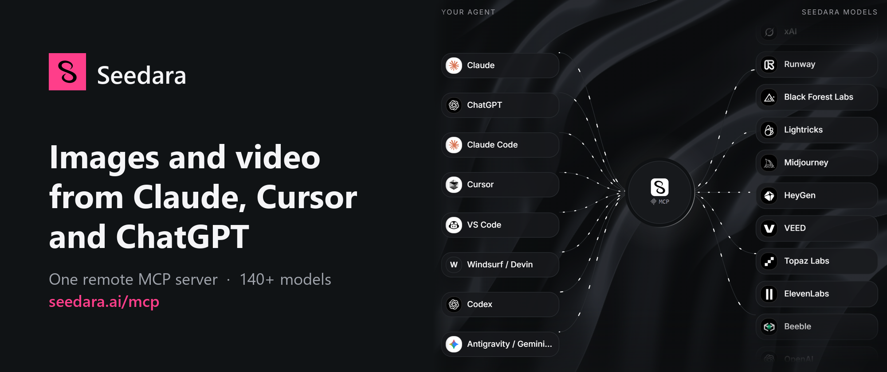
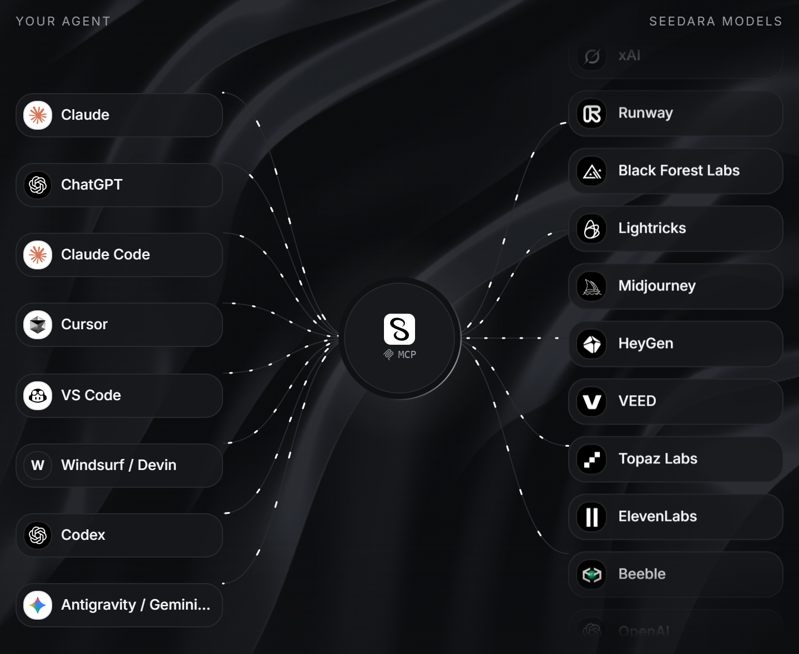
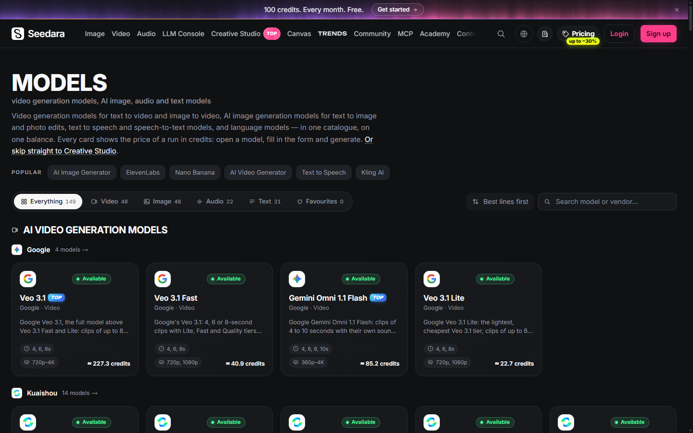

<p align="center">
  <a href="https://seedara.ai/mcp"></a>
</p>

<h1 align="center">Seedara MCP server</h1>

<p align="center">
  <b>AI video, image and audio generation inside your AI agent.</b><br>
  One remote MCP server · 140+ models · the price before every run · no API keys
</p>

<p align="center">
  <a href="https://seedara.ai/mcp">Website</a> ·
  <a href="#connect-your-agent">Connect</a> ·
  <a href="#tools">Tools</a> ·
  <a href="#models">Models</a> ·
  <a href="#pricing">Pricing</a> ·
  <a href="#faq">FAQ</a> ·
  <a href="examples/">Config examples</a>
</p>

<p align="center">
  <a href="https://registry.modelcontextprotocol.io/v0/servers?search=ai.seedara"></a>
  
  
  <a href="LICENSE"></a>
</p>

---

Claude, ChatGPT and Cursor are great at text and code, but they don't draw pictures or render video on their own. Connect Seedara to your agent and ask for images, video, music and voice right in the conversation: the agent picks the model, tells you the price before it runs and brings back the result.

```
Server URL:  https://seedara.ai/api/mcp
Transport:   Streamable HTTP
Auth:        OAuth (sign in to Seedara and press "Allow")
```

**This repository** holds the documentation, ready-to-copy client configs and the [MCP Registry](https://registry.modelcontextprotocol.io/) entry (`server.json`) for the hosted Seedara MCP server. The server itself runs at `https://seedara.ai/api/mcp`; there is nothing to install or self-host.

## Contents

- [Who it's for](#who-its-for)
- [How it works](#how-it-works)
- [Connect your agent](#connect-your-agent) — Claude, ChatGPT, Claude Code, Cursor, VS Code, Windsurf / Devin, Codex, Antigravity / Gemini CLI, other clients
- [Tools](#tools)
- [Try asking](#try-asking)
- [Models](#models)
- [Pricing](#pricing)
- [Money and safety](#money-and-safety)
- [FAQ](#faq)
- [Not connecting?](#not-connecting)
- [Links and support](#links-and-support)

## Who it's for

- **People who already work in an AI agent** and want pictures, clips, voice-overs or music without switching to another site.
- **Developers in Claude Code, Cursor or VS Code** who need an icon, a cover or a hero image for a project and want a file link right next to the code.
- **Anyone comparing models**: run the same prompt in two or three models and keep the best result, with the price known before each run.

## How it works

<p align="center">
  
</p>

1. **Copy the URL.** One URL for every agent: `https://seedara.ai/api/mcp`. No keys, no passwords.
2. **Add it to your agent.** The exact steps for each app are below.
3. **Sign in and allow.** The agent opens a Seedara window: sign in and press **Allow**.

Seedara may not show up in the agent right away. Sometimes it takes 5–10 minutes: wait and start a new chat.

## Connect your agent

Menu items are named as in each app. Ready-made config files are in [`examples/`](examples/).

<details open>
<summary><b>Claude</b> (claude.ai or the Claude app)</summary>

1. Open claude.ai or the Claude app → **Customize → Connectors**.
2. Press **+ → Add custom connector**, name it `Seedara`, paste the server URL and press **Add**.
3. Press **Connect** next to Seedara. The Seedara window opens: sign in and press **Allow**.
4. In a chat press **+ → Connectors** and turn Seedara on.

Free Claude allows one custom connector. On Team and Enterprise an Owner adds it: **Organization settings → Connectors → Add → Custom → Web**; then everyone presses **Connect** in **Customize → Connectors**.

Server URL: `https://seedara.ai/api/mcp`

</details>

<details>
<summary><b>ChatGPT</b></summary>

1. On chatgpt.com open **Settings → Security and login** and turn on **Developer mode**. No such toggle? Go to step 2: some accounts already have it on.
2. Open **Plugins** (chatgpt.com/plugins) and press **+ → Create app → Create MCP App**.
3. Name: `Seedara`, URL: the server URL, authentication: **OAuth**. Create the app, sign in to Seedara and press **Allow**.
4. In a new chat press **+** and pick Seedara.

Works on the ChatGPT website on paid plans. On Business and Enterprise an admin turns developer mode on first.

Server URL: `https://seedara.ai/api/mcp`

</details>

<details>
<summary><b>Claude Code</b></summary>

1. Run the command in a terminal. Seedara becomes available in all your projects:

   ```bash
   claude mcp add --transport http --scope user seedara https://seedara.ai/api/mcp
   ```

2. Start Claude Code, type `/mcp`, pick `seedara` and sign in in the browser. The Seedara window opens.
3. Or sign in from the terminal: `claude mcp login seedara`.

Example: [`examples/claude-code/install.sh`](examples/claude-code/install.sh)

</details>

<details>
<summary><b>Cursor</b></summary>

1. On [seedara.ai/mcp](https://seedara.ai/mcp) press **Install in one click** in the Cursor tab. Cursor asks whether to add the server.
2. Or paste the config into `~/.cursor/mcp.json` (per project: `.cursor/mcp.json`):

   ```json
   {
     "mcpServers": {
       "seedara": {
         "url": "https://seedara.ai/api/mcp"
       }
     }
   }
   ```

3. Turn `seedara` on in **Customize** in the sidebar and sign in to Seedara when Cursor opens the sign-in window.
4. Not connecting? **Output** (`Ctrl+Shift+U`) → **MCP Logs** shows the reason.

Example: [`examples/cursor/mcp.json`](examples/cursor/mcp.json)

</details>

<details>
<summary><b>VS Code</b></summary>

1. On [seedara.ai/mcp](https://seedara.ai/mcp) press **Install in one click** in the VS Code tab, or run **MCP: Add Server** from the Command Palette (`Ctrl+Shift+P`).
2. Or put the config into `.mcp.json` at the project root:

   ```json
   {
     "mcpServers": {
       "seedara": {
         "type": "http",
         "url": "https://seedara.ai/api/mcp"
       }
     }
   }
   ```

3. On first start VS Code asks you to sign in: the Seedara window opens. Seedara's tools are in Copilot Chat under **Configure Tools**.

Example: [`examples/vscode/.mcp.json`](examples/vscode/.mcp.json)

</details>

<details>
<summary><b>Windsurf / Devin</b></summary>

1. Windsurf is now called Devin Desktop. In the Cascade panel press **… → Open MCP config file**.
2. Add `seedara` to `mcp_config.json` and save. The file is in `~/.config/devin/`, on Windows in `%APPDATA%\devin\`.

   ```json
   {
     "mcpServers": {
       "seedara": {
         "serverUrl": "https://seedara.ai/api/mcp"
       }
     }
   }
   ```

3. Turn `seedara` on with its toggle in the **… → MCPs** menu. On the first call, sign in to Seedara and allow access.

Example: [`examples/windsurf-devin/mcp_config.json`](examples/windsurf-devin/mcp_config.json)

</details>

<details>
<summary><b>Codex</b></summary>

1. In a terminal, add the server and sign in. The Seedara window opens:

   ```bash
   codex mcp add seedara --url https://seedara.ai/api/mcp
   codex mcp login seedara
   ```

   Or add it to `~/.codex/config.toml`:

   ```toml
   [mcp_servers.seedara]
   url = "https://seedara.ai/api/mcp"
   ```

2. In the ChatGPT desktop app: **Settings → MCP servers → Add server**, type **Streamable HTTP**, the server URL. Save, press **Restart**, then **Authenticate**.
3. In the Codex IDE extension: **gear → MCP servers → Add server**, then **Restart extension**.

Examples: [`examples/codex/`](examples/codex/)

</details>

<details>
<summary><b>Antigravity / Gemini CLI</b></summary>

1. Since 18 June 2026 Gemini CLI has been replaced by Antigravity for free accounts. In Antigravity add `seedara` to `~/.gemini/config/mcp_config.json` or via `/mcp` in the CLI:

   ```json
   {
     "mcpServers": {
       "seedara": {
         "serverUrl": "https://seedara.ai/api/mcp"
       }
     }
   }
   ```

2. Open agent settings (`Ctrl+,`) → **Customizations → Authenticate** next to `seedara`. Sign in to Seedara, paste the code from the browser and press **Submit**.
3. In Gemini CLI: run the command in a terminal, then `/mcp auth seedara`:

   ```bash
   gemini mcp add --transport http -s user seedara https://seedara.ai/api/mcp
   ```

Examples: [`examples/antigravity/`](examples/antigravity/), [`examples/gemini-cli/`](examples/gemini-cli/)

</details>

<details>
<summary><b>Other clients</b></summary>

1. Any agent that speaks remote MCP (Streamable HTTP) with OAuth sign-in: paste the server URL.
2. If your agent only runs local servers, connect through [`mcp-remote`](https://www.npmjs.com/package/mcp-remote). It opens the sign-in window itself:

   ```json
   {
     "mcpServers": {
       "seedara": {
         "command": "npx",
         "args": ["-y", "mcp-remote", "https://seedara.ai/api/mcp"]
       }
     }
   }
   ```

Example: [`examples/mcp-remote/mcp.json`](examples/mcp-remote/mcp.json)

</details>

## Tools

Nine tools — the same ones the website runs on: moderation, limits and prices are identical. Set a price limit, or pay from your team's pool.

| Group | Tool | What it does |
|---|---|---|
| Create | `generate` | Start a generation: images arrive right in the chat |
| Create | `get_generation` | Status and result of a long run — video, music |
| Choose and price | `list_models` | Image, video and audio models with prices |
| Choose and price | `get_model` | A model's settings: formats, duration, quality |
| Choose and price | `get_price` | The exact price before the run |
| Choose and price | `get_balance` | How many credits are left |
| Yours | `upload_file` | Your own photo, video or recording — by link or as a file |
| Yours | `list_elements` | Your characters, locations, products and voices — the same hero in every shot |
| Yours | `list_generations` | Your latest work with links |

Here is what a call looks like in Claude:

```text
You:     Draw a blonde by a pink sports car at a night gas station, like a film still.
Claude:  seedara · generate(model: "nano-banana-2-new",
                           prompt: "blonde by a pink sports car at a night gas station, film still",
                           params: {"size": "16:9"})
         Done — nano-banana-2-new (image).
         Result: https://seedara.ai/api/files/…
         Charged: … credits.
```

Images come back in the chat. Video and music take from a minute to a few: the agent gets a generation id and checks `get_generation` later by itself, or you ask it to.

## Try asking

Copy and paste into your agent:

| Type | Prompt |
|---|---|
| Image | «Remove the background from this photo with Seedara and make it white, for no more than 20 credits: https://example.com/photo.jpg» |
| Image | «Make three cover options in Seedara for a morning-coffee video, 16:9. Tell me the price first.» |
| Video | «Which Seedara models make video with sound? Compare their price for 5 seconds.» |
| Video | «Animate the latest picture in my Seedara library: slow push-in, 5 seconds.» |
| Audio | «Write a 30-second jingle for a coffee shop with Seedara — warm, acoustic.» |
| Balance | «How many Seedara credits do I have and what will they buy?» |

## Models

Seedara has 140+ models from 19+ developers. Over MCP your agent gets the image, video and audio models; text models (GPT, Claude, Gemini and others) stay in the Seedara chat, because your agent already has a language model of its own.

A selection from the [model catalogue](https://seedara.ai/models):

| Type | Developers and models |
|---|---|
| **Video** | Google Veo 3.1 (Fast, Lite) · Kuaishou Kling 4.0, Kling 3.0, Kling 2.6, Kling Avatar 2 · ByteDance Seedance 2.5, Seedance 2.0, OmniHuman 1.5 · MiniMax Hailuo 2.3 · Alibaba Wan 3.0 · Runway Gen-4.5, Aleph 2, Act-Two · xAI Grok Imagine · Black Forest Labs Flux 3 Video · HeyGen Avatar IV · VEED Fabric 1.0 · Topaz Video Upscale · ElevenLabs Dubbing V2 |
| **Image** | OpenAI GPT Image 2.5, GPT Image 2 · Google Nano Banana Pro, Nano Banana 2 · ByteDance Seedream 5 · Black Forest Labs Flux 2, Flux Kontext · Midjourney V7 · xAI Grok Imagine Image 2.0 · Alibaba Wan 2.7 Image · Kling 3.0 Omni Image, Kling Virtual Try-On · Ideogram 3.0 · Recraft V4.1 (incl. vector), Remove Background · Runway Gen-4 Image · Topaz Enhance, Sharpen, Denoise |
| **Audio** | ElevenLabs V3, Multilingual v2, Dialogue, Music, Speech to Text · Suno Music, Extend, Lyrics, Split vocals · Google Gemini 3.8 Flash TTS · MiniMax Speech 2.8, Voice Clone, Voice Design · OpenAI Whisper Large V3 Turbo · Kling Video to Audio, Text to Audio |

The catalogue changes as new models arrive; ask your agent `list_models` for the current list with prices.

<p align="center">
  <a href="https://seedara.ai/models"></a>
</p>

## Pricing

- **Connecting is free.** A generation through an agent costs what it costs on the site. A failed one is refunded.
- **Free plan:** 100 credits every 30 days for images, audio and text. No video on the Free plan.
- **Paid plans:** Starter $19, Plus $59 and Ultra $129 a month (2,000 / 6,500 / 15,000 credits); 30% off with yearly billing. Video models start from the Starter plan.
- **Teams:** a shared balance, roles and spend per person, from 3 seats.

Details and the current prices: [seedara.ai/pricing](https://seedara.ai/pricing).

## Money and safety

The agent signs in with your Seedara account through OAuth.

| It will be able to | It won't be able to |
|---|---|
| Make images, video and audio on your credits | Pay or top up |
| See prices and your balance | See your password, e-mail or payment methods |
| See your generations | Change account settings |

- **Credits as on the site.** A generation through an agent costs what it costs on the site. A failed one is refunded.
- **No keys or passwords.** You sign in with your Seedara account. The agent never sees your password, e-mail or payment methods.
- **Only what's yours.** The agent sees models, prices, your balance, your generations, elements and uploads — nothing else. It cannot pay or change sign-in or account settings.
- **Disconnect in one click.** On [seedara.ai/mcp](https://seedara.ai/mcp) under **Your connections**. Changing your password or **Sign out everywhere** disconnects every agent at once.

## FAQ

<details>
<summary><b>Does Claude generate images?</b></summary>

Not by itself: Claude writes text and code. With Seedara connected over MCP, Claude can make images too: it picks a model such as Nano Banana or GPT Image, tells you the price and shows the picture in the chat. This is Anthropic's Claude using Seedara's models, not a Claude image model.
</details>

<details>
<summary><b>Can Claude generate videos?</b></summary>

Yes, through Seedara. Ask in the chat, and Claude starts a video with a model such as Kling, Veo or Seedance, tells you the price first and brings the clip back when it's ready. Video models start from the Starter plan; the Free plan has no video.
</details>

<details>
<summary><b>Can Claude Code generate images?</b></summary>

Yes, once Seedara is added: one command in the terminal, then sign in. Claude Code can then make images and video for your project, such as icons, covers or a hero picture, and gives you a link to each file.
</details>

<details>
<summary><b>Is this the ElevenLabs, HeyGen or Nano Banana MCP server?</b></summary>

No. It's Seedara's own MCP server, not an official server of those companies. Through it your agent can use models from many developers on one Seedara balance — ElevenLabs voices, Nano Banana, Kling, HeyGen and others.
</details>

<details>
<summary><b>What does MCP cost?</b></summary>

Connecting is free. Generations use credits at the same prices as on the site.
</details>

<details>
<summary><b>Do I need an API key?</b></summary>

No. The agent opens a Seedara window, you sign in and press Allow. Access lasts while you use it and can be switched off on the MCP page.
</details>

<details>
<summary><b>Why are there no text models over MCP?</b></summary>

Your agent already has a language model of its own. MCP brings images, video and audio. To talk to GPT, Claude or Gemini, use the Seedara chat.
</details>

<details>
<summary><b>The agent says the video is "still in progress".</b></summary>

That's normal: video and music take from a minute to a few. The agent checks the status later by itself — or ask it to.
</details>

<details>
<summary><b>Can I give the agent my own picture?</b></summary>

Yes. Give the agent a link to your photo, video or recording, or the file itself — it uploads it to Seedara (free) and it also shows up in your Library under Uploads. Your earlier generations work too.
</details>

## Not connecting?

- **The agent doesn't see Seedara after connecting.** Give it a few minutes: in some agents, Claude and ChatGPT especially, the connection appears after 5–10 minutes. Then check that Seedara is turned on in the chat and start a new chat.
- **The sign-in window never opened.** Remove Seedara from the agent and add it again.
- **Cursor:** **Output** (`Ctrl+Shift+U`) → **MCP Logs** shows the reason.
- **Your agent only runs local servers:** use the [`mcp-remote`](#connect-your-agent) config under *Other clients*.
- **Still stuck?** [Open an issue](https://github.com/seedara-ai/seedara-mcp/issues/new/choose) or write to support@seedara.ai.

## Links and support

- Website: [seedara.ai](https://seedara.ai)
- MCP page with one-click install: [seedara.ai/mcp](https://seedara.ai/mcp)
- Models: [seedara.ai/models](https://seedara.ai/models)
- Pricing: [seedara.ai/pricing](https://seedara.ai/pricing)
- Official MCP Registry: `ai.seedara/mcp`
- Questions and ideas: [Discussions](https://github.com/seedara-ai/seedara-mcp/discussions)
- Bugs: [Issues](https://github.com/seedara-ai/seedara-mcp/issues)
- Security: [SECURITY.md](SECURITY.md)
- Support: support@seedara.ai

## License

The documentation and config examples in this repository are released under the [MIT License](LICENSE). The Seedara service and its MCP server are provided under the [Seedara Terms of Use](https://seedara.ai/terms).
